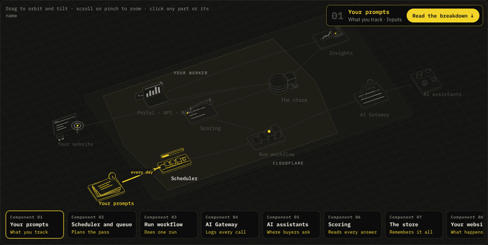
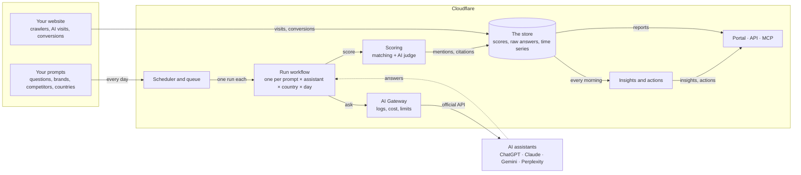
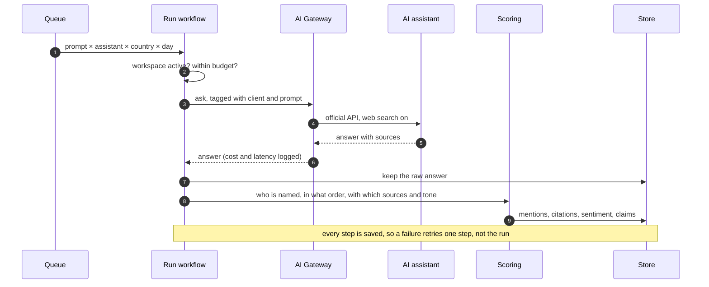
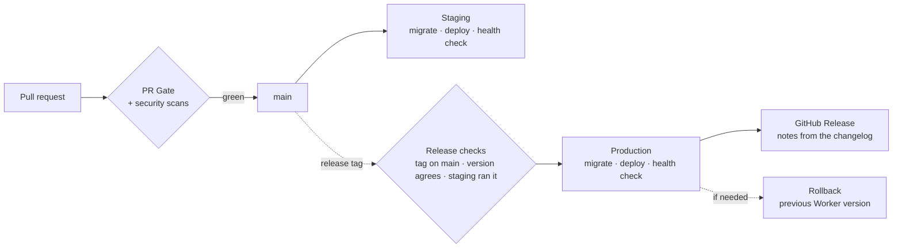

# GEO Observability — AI answer visibility with an observability layer

[](https://github.com/Organized-AI/geo-observability/actions/workflows/ci.yml)
[](https://github.com/Organized-AI/geo-observability/actions/workflows/security.yml)
[](https://github.com/Organized-AI/geo-observability/actions/workflows/deploy-staging.yml)
[](https://github.com/Organized-AI/geo-observability/actions/workflows/release.yml)

**Live app:** [app.organizedai.vip/geo-observability](https://app.organizedai.vip/geo-observability) · **How it works in 3D:** [/how-it-works](https://app.organizedai.vip/geo-observability/how-it-works/) · **User guide:** [/docs](https://app.organizedai.vip/geo-observability/docs/)

A Cloudflare-native tool that shows where AI assistants recommend a brand, and what those answers are worth. It is for agencies and in-house teams who need to know whether ChatGPT, Claude, Gemini and Perplexity name their brand, which sources those answers lean on, and whether AI traffic turns into revenue. For each client it delivers:

1. **Tracking.** The questions buyers ask, put to every assistant on a schedule, per country, with the raw answer kept and every call logged.
2. **Scores.** Visibility, share of voice, position, sentiment, win rate and citations, plus brand perception and fact checks against the facts you set.
3. **Observability.** AI crawlers and AI-referred visits captured at the edge, and server-side conversions, joined to the pages the answers cite.
4. **Actions.** Daily insights, ranked actions and content briefs, written from the evidence.
5. **Access.** A client portal, read-only share links, a REST API and an MCP server, so people and their AI tools see the same numbers.

## How it works

[](https://app.organizedai.vip/geo-observability/how-it-works/)

**[Open the interactive 3D map →](https://app.organizedai.vip/geo-observability/how-it-works/)** Drag to orbit, click any part for its breakdown, or press Run the loop for a guided tour. GitHub can't run interactive 3D inside a README, so the animation above is a recording and links to the live page.



### One run, step by step



### How it ships



Git is the only way a change reaches Cloudflare. Every merge deploys staging; production changes only from a version tag, and every deploy reports its version on a health check. Details: [DOCUMENTATION/gitops.md](DOCUMENTATION/gitops.md).

---

## Quickstart (local, no accounts)

```bash
npm ci
npm run db:migrate:local && npm run seed:demo:local
npm run dev:offline      # the landing page, the demo portal at /app/, the guide at /docs/, the 3D map at /how-it-works/
npm run check            # types, lint, tests, version and infra checks, docs, bundles
```

No Cloudflare login and no provider keys are needed. Assistants without a key answer from a clearly labelled stub and AI features fall back to rules, so the whole loop runs end to end.

## Deploy

```bash
npm run infra:plan -- --env staging      # what an environment has in Cloudflare and what it is missing
npm run infra:apply -- --env staging     # create what is missing
npm run release:prepare -- minor         # turn the changelog into a version; merge it, then tag main to release
```

One-time setup, releases and rollback: [DOCUMENTATION/gitops.md](DOCUMENTATION/gitops.md). Secrets, the public address and sign-in email: [DOCUMENTATION/deploy.md](DOCUMENTATION/deploy.md). Infrastructure per environment: [infra/README.md](infra/README.md).

## Design choices

| Choice | Why |
|---|---|
| **Official APIs through AI Gateway, never scraped UIs** | Every answer is reproducible, costed and logged in one place, and nothing signs in to a third-party app. |
| **Deterministic scoring first, AI judge second** | Mentions and rank come from matching, so the numbers are stable from day to day; the judge adds tone, perception and claim checks, with a rules fallback. |
| **One small workflow per run** | Each prompt, assistant, country and day is its own run, saved step by step, so a slow or failed answer retries alone and never costs a whole pass. |
| **Edge capture without log pipelines** | A small tap on the client's site records AI crawlers and AI referrals directly, so the observability layer works without exporting CDN logs. |
| **Tenant isolation in one place** | Every query for client data goes through one database layer that always scopes it to the workspace. |
| **Labelled stub, never a silent gap** | A missing provider key never breaks a pass, and a stub answer is marked as one wherever it shows. |
| **Staging mirrors production and shares nothing** | Its own Worker and its own copy of every resource; a check in CI fails if staging would touch production. |
| **Releases are tags** | Production moves only on a version tag that agrees with the changelog, and the running version is visible on a health check. |

## Project layout

Organized Codebase layout; [CLAUDE.md](CLAUDE.md) has the conventions and the rules for coding agents.

```
src/                      the Worker
  engines/ · judge/       assistant clients through AI Gateway, stub · mention matching, AI judge
  workflows/ · durable/   scheduler, run workflow, pipeline steps · live pass progress
  metrics/ · insights/    reports, filters, rollups · insights, actions, briefs
  observability/          crawler and referral classification, ingest, the Pages table
  routes/ · mcp/          portal API, public API, sign-in, billing routes · MCP server
  billing/ · lib/         billing and metering · database layer, auth, sessions, mail, base path
public/                   landing page, portal, signup, sign-in, user guide, 3D map (how-it-works/), site tag
docs-src/                 user guide sources → npm run build:docs
edge/                     tap Worker for a client's site
migrations/               database schema, append-only
infra/                    every resource per environment
scripts/                  deploy, infra, version, docs build, demo seed, offline dev, billing setup
test/ · test-scripts/     Workers-runtime tests · tests for the delivery tooling
ARCHITECTURE/ · PLANNING/ · SPECIFICATIONS/ · DOCUMENTATION/ · AGENT-HANDOFF/ · CONFIG/   Organized Codebase docs
```

## Making changes quickly

| To… | Do this |
|---|---|
| Add an assistant | Add a client in `src/engines/`, register it, and list its key for each environment in `infra/` |
| Change a model | Edit the model var in `wrangler.jsonc` for production and staging |
| Change the schema | Add the next numbered file in `migrations/`; keep it compatible with the running release |
| Add a binding | Add it to production and staging with different names, then `npm run infra:check` and `infra:apply` |
| Change the 3D map | Edit the parts, links and tour in `public/how-it-works/anatomy3d.js` |
| Write user docs | Edit `docs-src/`, run `npm run build:docs` |
| Ship | Pull request → merge (staging) → `npm run release:prepare` → tag (production) |

## Support, contributing and security

- **Contributing:** [CONTRIBUTING.md](CONTRIBUTING.md) (branching, checks, changelog, releases) and [CLAUDE.md](CLAUDE.md) (repo map and rules for coding agents).
- **Security:** [SECURITY.md](SECURITY.md). Secrets live only in Cloudflare and GitHub; secret, workflow and dependency scans run on every pull request.
- **Changes:** every release is in [CHANGELOG.md](CHANGELOG.md).

## Limitations and next steps

- **Assistants need keys.** Until provider keys are set, each assistant answers from the labelled stub.
- **Alexa** can't be tracked: there is no public way to read its answers.
- **Billing** runs in test mode until live billing is approved.
- **The 3D map** needs WebGL; without it, the page still lists and explains every part.
